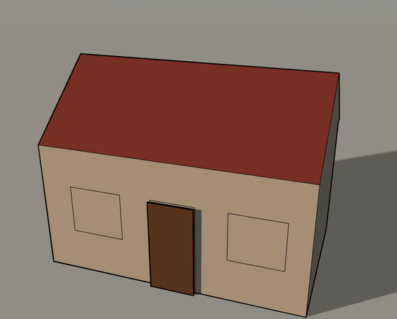
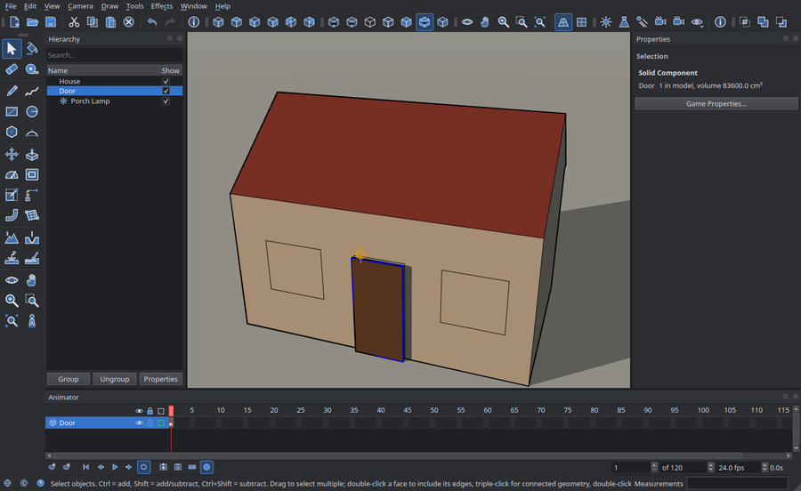
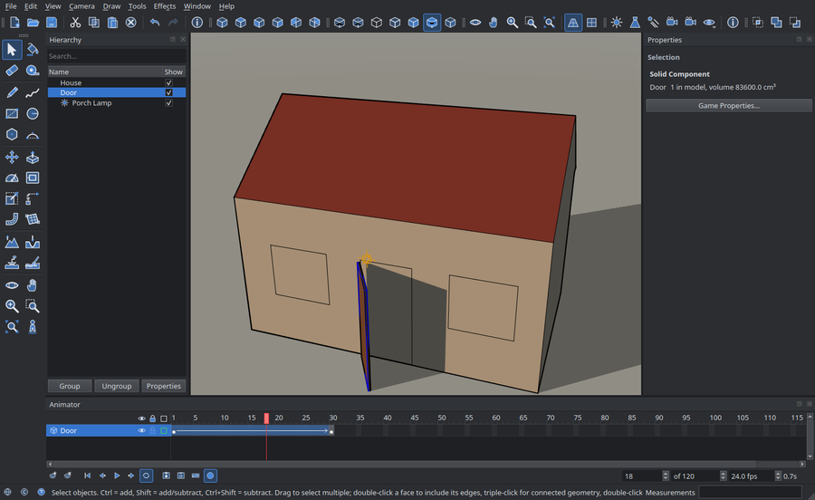
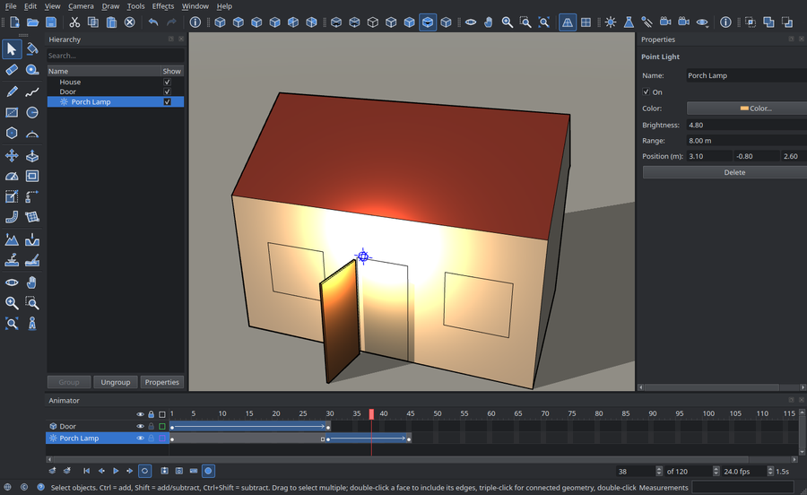

# Animating with the Animator

The Animator is a timeline, like Flash's: every moving thing has a **layer**, and
**keyframes** on it say where the thing is at that moment. Between two keyframes a
**motion tween** moves it smoothly; without one it stays put until the next keyframe.
It animates component placements (position, rotation, scale), lights (position, aim,
colour, brightness, range, cone) and cameras. The timeline is saved with the model.

This example opens a door and switches on the porch lamp once it is open.

## 1. Make the door a component and give it a layer

Draw the door, select it, right-click → **Make Component** (or Edit → Make
Component). Open the timeline with **Window → Animator**, select the door and press
**New Layer** (the first button below the layers). The layer gets the door's name,
an eye (show or hide), a lock (no changes) and a colour, and a first keyframe (the
black dot) at the playhead: the door, closed, at frame 1.

## 2. Move the playhead, then move the door

Click frame **30** on the ruler (the red playhead jumps there), take the
**Rotate** tool and turn the door on its hinge. With **Auto Key** on (the red
circle button, on by default) a keyframe appears at frame 30 by itself; you can
also press **F6** (Insert Keyframe). The span between the two keyframes turns blue
with an arrow: a **motion tween**. Scrub the playhead back and forth: the door swings
on the hinge, turning rather than sliding, because rotations are blended as
rotations.

## 3. A light that waits, then comes on

Select the lamp (Scene toolbar → Point Light places one) and press **New Layer**.
At frame 30 give it a little brightness in the **Properties** panel, at frame 45 its
full brightness. Right-click the span from frame 1 and choose **Remove Motion
Tween**: it turns grey and the lamp holds (off) until frame 30, then fades in up to
frame 45.

## 4. Play it

The buttons below the timeline: first frame, previous keyframe, **play/pause**,
next keyframe, loop. Set the **frame rate** (fps) and the **length** on the right;
the elapsed time is shown beside them.

## Editing the timeline

| To | Do |
|---|---|
| Add a keyframe | F6, double-click a frame, or change the thing with Auto Key on |
| Remove a keyframe | Shift+F6 on it, or right-click → Clear Keyframe |
| Move a keyframe | Drag the dot to another frame |
| Tween or hold | Right-click a span → Create / Remove Motion Tween |
| Rename a layer | Double-click its name |
| Hide or protect | The eye and the lock of the layer |
| Delete a layer | The second button below the layers, or right-click → Delete Layer |

Every change to the timeline is one undo step, including a keyframe Auto Key adds
(undoing the move takes its keyframe away too). While a component is open for
editing, the timeline leaves it alone until you close it.

## More ways to animate

- **Animation states** move the parts *inside* a component (a door's leaf, a lid):
  record poses by name (Tools → Record State) and the component's **Game
  Properties** (func_door, func_button, func_actor, or a JavaScript script) play them
  in [Game Mode](DOCUMENTATION.md#game-mode).
- **Physics**: any component can be a rigid body with mass, friction and bounce.

The Animator's timeline plays in the editor; playing it in Game Mode is planned.
