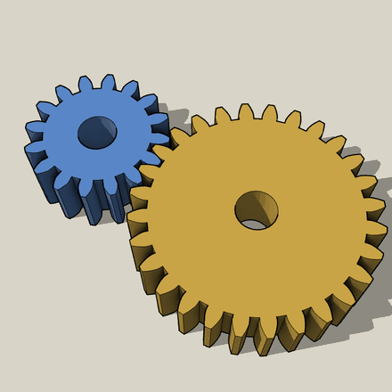
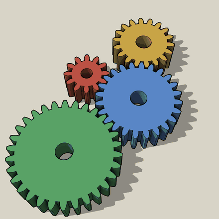
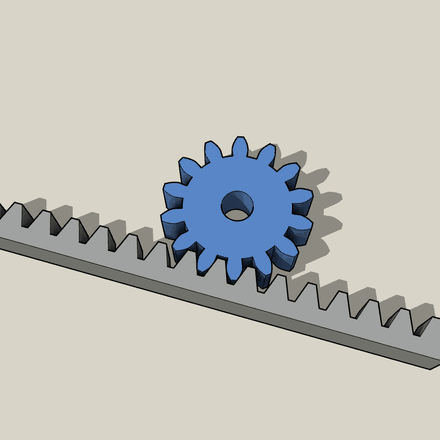
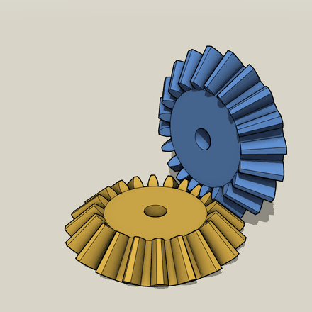
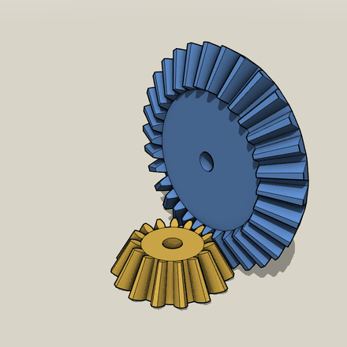
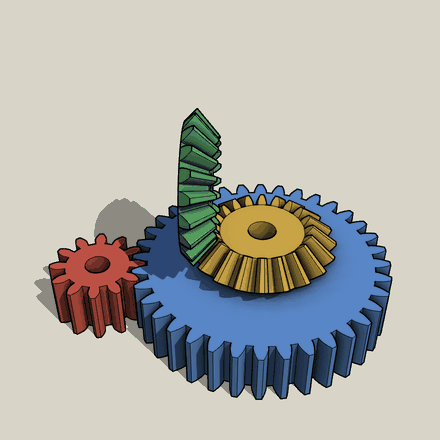
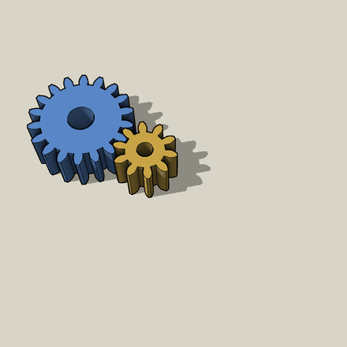
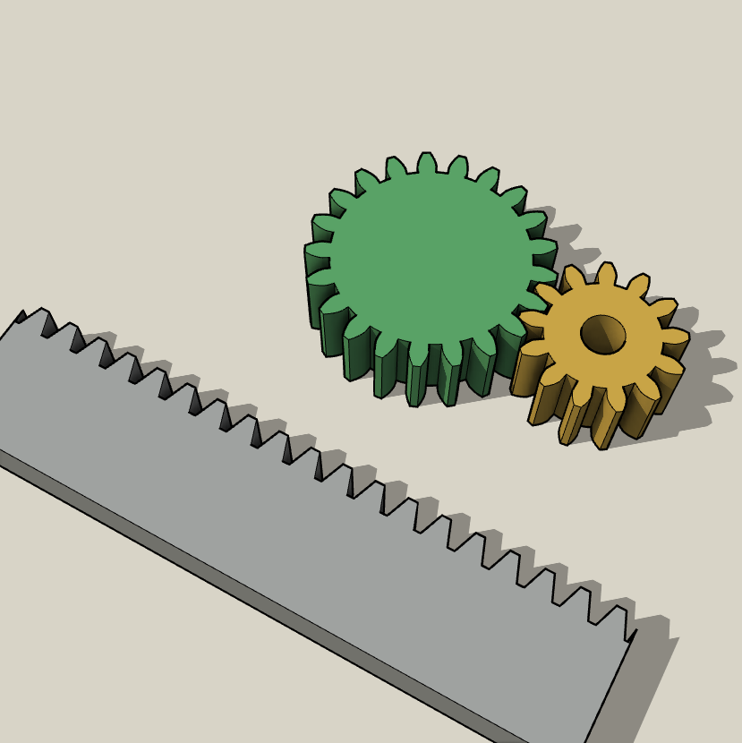

# Gears in Forma

Forma makes real, standard gears that mesh with each other: involute spur gears,
gear racks and bevel gears. You can make them without knowing gear engineering:
choose a tooth size and how big the gear should be, and the program works out the
rest and places gears already meshing. The engineering settings (module, number of
teeth, pressure angle, backlash) are one click away when you need them.

* [The one rule: same tooth size](#the-one-rule-same-tooth-size)
* [Quick start](#quick-start)
* [Junctions](#junctions)
  * [Parallel shafts: two spur gears](#parallel-shafts-two-spur-gears)
  * [Gear trains](#gear-trains)
  * [Turning into sliding: rack and pinion](#turning-into-sliding-rack-and-pinion)
  * [Shafts at right angles: bevel gears](#shafts-at-right-angles-bevel-gears)
  * [Combining them: a drivetrain](#combining-them-a-drivetrain)
* [Sizing by eye](#sizing-by-eye)
* [Gears from your own shapes: Gear Notches](#gears-from-your-own-shapes-gear-notches)
* [For engineers](#for-engineers)
* [Tips for 3D printing](#tips-for-3d-printing)
* [Limits](#limits)

The animations below were rendered by Forma itself (`GS_SHOTS=gears
tools/readme-media.sh`), with every gear turning at its true ratio.

## The one rule: same tooth size

**Gears mesh when their teeth are the same size.** The tooth size is called the
**module** (in millimetres). A gear of module 1 with 20 teeth is 20 mm across where
it touches other gears (its *pitch diameter*), and its teeth are π × 1 = 3.14 mm
apart. A module 1 gear with 40 teeth is 40 mm across and has the same teeth.
So every module 1 gear meshes with every other module 1 gear and rack, whatever
their size. The tooth flanks must also lean the same way (the **pressure angle**,
almost always 20°).

That is all Forma needs from you. Pick a module once for a project (1 mm is
a good size for small 3D-printed mechanisms, 1.5–2 mm for sturdier ones), and only
change sizes.

## Quick start

1. **Draw → Mechanical → Spur Gear…**. Leave **Choose by** on *Size*, pick a
   **Tooth size**, type a **Diameter** (across the tips) and a **Thickness**, then
   click **Place**. The gear follows the cursor; click to put it down.
2. Select that gear and open **Draw → Mechanical → Spur Gear…** again. **Fit to**
   now shows the selected gear and takes its tooth size, so you only choose the new
   gear's size. With **Place it next to the selected gear, meshing** ticked, the
   new gear is placed beside the first at the right distance, turned so its teeth
   sit in the first gear's gaps.
3. Do the same for a rack (**Gear Rack…**, it goes under the gear) or bevel gears
   (**Bevel Gear…**, for shafts at right angles).

The dialog always shows what you will get: the number of teeth, the real
diameters, how far apart the centres are, and how fast the new gear turns compared
with the one it fits. Every gear remembers its settings, so you can fit new gears
to it later, even after saving and reopening the model.

## Junctions

### Parallel shafts: two spur gears

The most common junction: two spur gears on parallel shafts. The small gear
(16 teeth) drives the large one (28 teeth). They turn in **opposite directions**,
and the large one turns **28 / 16 = 1.75 times slower**, with 1.75 times the
torque.

| | Small gear | Large gear |
|---|---|---|
| Module | 1 mm | 1 mm (fitted) |
| Teeth | 16 | 28 |
| Pitch diameter | 16 mm | 28 mm |
| Distance between the shafts | 22 mm = (16 + 28) / 2 | |

How to make it:
1. Spur Gear… → Size, tooth size 1, diameter 18 mm (16 teeth + 2 × module across
   the tips). Place.
2. Select it, Spur Gear… → diameter 30 mm → Place. It lands 22 mm away, meshing.

The speed ratio is always the ratio of the tooth counts, and the shaft distance is
always module × (teeth₁ + teeth₂) / 2. Drill your shaft holes that far apart and
the gears will mesh.

### Gear trains

A train passes motion through several gears. Here the red 12-tooth pinion drives
the blue 24-tooth gear, which drives two more: yellow (18 teeth) and green (30
teeth).

* Each pair turns in opposite directions, so yellow and green turn **the same way
  as the red pinion**. A gear between two others that only passes motion on is an
  *idler*: it reverses the direction, but its size does not change the overall ratio.
* The ratio from start to end is the first gear's teeth over the last gear's:
  red → green is 12 / 30, so green turns at 0.4 × the red pinion's speed; red →
  yellow is 12 / 18 ≈ 0.67 ×.

How to make it: place the first gear, then select each gear in turn and add the
next with **Fit to** + **Place it next to the selected gear, meshing**. New gears
go to the right of the selected one (+X in its own axes). To put one somewhere else
around it, rotate it about the selected gear's axis by a whole number of that
gear's teeth (360° / teeth per tooth), and it still meshes.

### Turning into sliding: rack and pinion

A **rack** is a straight gear. A spur gear turning on it (the *pinion*) moves it
along, or rolls along it. The rack moves **π × pitch diameter per turn** of the
pinion: here a 14-tooth pinion of module 1.5 (pitch diameter 21 mm) moves the rack
66 mm per turn. Racks are used in steering, linear slides, sliding gates and CNC
axes.

How to make it: select the pinion and open **Draw → Mechanical → Gear Rack…**. The
rack takes the pinion's tooth size. Choose its **Length** (rounded to whole teeth,
π × module apart), and **Place it under the selected gear, meshing** puts its
pitch line on the pinion's pitch circle. The other way round also works: select a
rack, add a Spur Gear fitted to it, and the gear is set on top of the rack.

### Shafts at right angles: bevel gears

**Bevel gears** turn the motion through 90°: the shafts cross at right angles, as
in a hand drill, a differential or a corner drive. Their teeth sit on a cone and
get smaller towards its tip. The tips of the two cones meet at the point where the
shafts would cross.

* **Miter pair (left, 20 + 20 teeth):** both cones are at 45°, so the teeth stand
  at 45° and the speed is unchanged (1:1). Only the direction turns.
* **Reduction pair (right, 15 + 30 teeth):** cones of 26.6° and 63.4°. The large gear
  turns at half the speed. The cone angle is atan(teeth / mate's teeth).

Unlike spur gears, **a bevel gear is made for one mate**: its cone depends on both
tooth counts. So the dialog asks for both sizes (*Diameter* and *Other gear's
diameter*, or both tooth counts) and by default places **both gears**, meshing, as
one component. Explode it to move the gears separately. To add the mate of a bevel
gear already in the model, select it and open Bevel Gear…: **Fit to** makes exactly
the gear it needs and puts it on the selected one.

**Tooth length** is the face width along the cone: *Auto* uses a third of the
cone's length, and it can be at most half.

### Combining them: a drivetrain

Gears on the same shaft turn together, so junctions chain. Here a motor pinion
(red, 12 teeth) drives a large spur gear (blue, 36 teeth): 3:1 slower. A bevel gear
(yellow) sits on the same shaft as the blue gear and drives its mate (green) at
1:1 on a horizontal shaft. The output turns at a third of the motor's speed, through
90°.

How to make it:
1. Place the pinion, then the 36-tooth gear fitted and placed next to it.
2. Place a bevel pair (Bevel Gear…, both sizes equal, *Place both gears*). Explode
   it, then move the first bevel gear onto the blue gear's axis, on top of it. Use
   the axis as the snapping point.
3. Group (Make Component) the blue gear and the bevel gear on its shaft, or keep
   them as separate parts on one shaft.

## Sizing by eye

With **Choose by: Size**, you type roughly how big a gear should be. Forma
rounds it to the nearest whole number of teeth of your tooth size: a gear can't
have 20.4 teeth. Because the tooth size stays the same, the gear meshes with the
others at every size. The dialog shows the size you actually get. In the animation
the right gear grows from 10 to 40 teeth and stays meshed with the 18-tooth gear
on the left; only the distance between the shafts changes.

* Spur gear **Diameter** is across the tips: teeth = diameter / module − 2.
* Rack **Length**: teeth = length / (π × module).
* Bevel **Diameter**: the pitch diameter at the large end, teeth = diameter / module.

## Gears from your own shapes: Gear Notches

**Effects → Shape → Gear Notches** puts teeth on anything selected: a circle, the
edges of a face, a line. Set **Spacing by** to *Standard tooth size (fits other
gears)* and it makes real gear teeth of a module:

* **A circle** is taken as the gear's pitch circle. With *Resize circles to whole
  teeth* it is resized to the nearest whole number of teeth and becomes exactly the
  same involute gear as Draw → Mechanical → Spur Gear. In the picture, a circle
  about 21 mm across became the green 21-tooth gear, and a 13-tooth Spur Gear of
  the same module meshes with it at 17 mm.
* **Straight edges** get rack teeth exactly π × module apart. The line is the pitch
  line: teeth stand 1 × module above it and gaps go 1.25 × module below. Whole
  teeth are centred on each straight side, so the corners stay where they are. The
  grey plate's top edge became a rack.

Then push/pull the face to the thickness you want. This is how to put a rack along
the edge of a part you already drew, or teeth on a round part of a bigger model.
Only the module, pressure angle and *Resize circles* show in this mode. The other
spacing modes (number of teeth, distance between teeth) still make decorative or
custom notches.

## For engineers

Switch **Choose by** to *Module and number of teeth (engineering)* to set
everything directly: module (any value, with the ISO 54 series offered), number of
teeth, pressure angle (20° standard; 14.5° and 25° offered), backlash and the
number of pieces per involute flank.

| Quantity | Spur gear | Rack | Bevel gear (large end) |
|---|---|---|---|
| Pitch diameter d | m · z | — | m · z |
| Tip (outside) diameter | m · (z + 2) | tips m above the pitch line | d + 2 m cos δ |
| Root diameter | m · (z − 2.5) | roots 1.25 m below | d − 2.5 m cos δ |
| Base diameter | d · cos α | — | — |
| Circular pitch | π · m | π · m | π · m |
| Centre distance (pair) | m · (z₁ + z₂) / 2 | pitch line at d/2 from the gear's centre | shafts at 90°, cone apexes together |
| Cone angle δ | — | — | atan(z / z_mate) |

* Profiles are true involutes from the base circle (with a radial flank below it
  when the root circle is smaller), on the ISO 53 basic rack: addendum 1 m,
  dedendum 1.25 m.
* **Backlash** is taken off each tooth's thickness at the pitch circle. Meshing
  gears are placed at the exact centre distance, so the backlash shows as a gap.
* **Undercut:** with fewer than 2 / sin² α teeth (17 at 20°), a hobbed gear would
  be undercut. The dialog warns, and the undercut is not modelled.
* **Bevel gears** use Tredgold's approximation: on the back cone each tooth is the
  tooth of a virtual spur gear of z / cos δ teeth. Every tooth line runs to the
  cone apex, so teeth scale evenly from the large end to the small end. Module and
  diameters are given at the large end.
* Each gear keeps its parameters with its component (`formaGear` in the
  component's data in the .forma file), so **Fit to** works on saved models.
  Spur gears and racks from 0.3.2 are recognised from their names, with a 20°
  pressure angle assumed.

## Tips for 3D printing

* Add **backlash** of about 0.1–0.2 mm (engineering mode) so printed gears don't
  bind, or scale the shaft distance up slightly.
* Use at least module 1 for FDM printers, and at least 12–15 teeth to avoid weak,
  undercut teeth.
* **Flank pieces** sets how smooth the tooth curve is; 6–10 is plenty for printing.
* Bevel gears print best standing on their large end, as they are modelled.
* Export with File → Export → STL/3MF; see the main documentation.

## Limits

* Bevel gears are for shafts at exactly 90°. Spiral bevel, hypoid and crossed
  helical gears are not available yet, nor helical spur gears, worm drives or
  internal (ring) gears with involute teeth. Gear Notches on a hole makes internal
  teeth with straight (rack-shaped) flanks, which is fine for light duty only.
* Meshing placement puts the new gear on one side (+X of the selected gear's own
  axes). Rotate it around the selected gear's axis by whole teeth to move it
  elsewhere.
* A gear that was scaled after placing is not offered for meshing placement: its
  teeth no longer match its recorded module.
