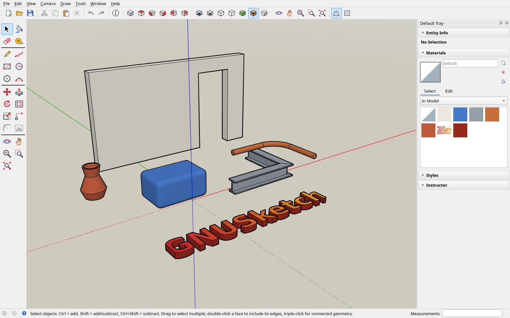

# GNUSketch

[](https://github.com/Dev1lroot/GNUSketch/actions/workflows/ci.yml)
[](LICENSE)

A free, native Linux 3D sketching tool with a push/pull workflow, written from
scratch in C++20 with Qt 6 Widgets and OpenGL 3.3 (core profile). Clean-room design:
no proprietary formats, code or artwork. All icons are original inline SVGs.



> **Status: early alpha (0.1).** The core modelling tools work. Expect rough edges
> and see "Not implemented yet" below.

## Build

```sh
cmake -S . -B build -DCMAKE_BUILD_TYPE=RelWithDebInfo
cmake --build build -j
./build/gnusketch            # or: ./build/gnusketch model.gsketch
```

Requirements: a C++20 compiler, CMake ≥ 3.21, Qt ≥ 6.4 (Core, Gui, Widgets, OpenGL,
OpenGLWidgets, Svg) and an OpenGL 3.3 capable driver. Works on Wayland and X11.

Debian/Ubuntu packages:

```sh
sudo apt install build-essential cmake qt6-base-dev libqt6opengl6-dev libqt6svg6-dev qt6-image-formats-plugins
```

Fedora: `sudo dnf install gcc-c++ cmake qt6-qtbase-devel qt6-qtsvg-devel qt6-qtimageformats`
Arch: `sudo pacman -S cmake qt6-base qt6-svg qt6-imageformats`

Install system-wide with `sudo cmake --install build`.

Tests (none of them open a window on your desktop):

```sh
cd build && ctest                 # geometry kernel + file format tests
tools/headless-selftest.sh        # drives the real UI with synthetic input on Xvfb
./build/gnusketch --gl-probe      # renders one frame offscreen on your GPU, prints driver info
```

If the window does not open, run `./build/gnusketch --gl-probe` from a terminal and
include its output in the bug report.

## Plugins

File formats can come as plugins: shared libraries GNUSketch loads at start from
`GNUSKETCH_PLUGIN_PATH`, `~/.local/share/GNUSketch/GNUSketch/plugins`,
`<prefix>/lib/gnusketch/plugins` and `plugins/` beside the executable (Help > Plugins
lists what was found). A plugin adds File > Open / Import / Export entries for its
format, and may add a tab of its own to a component's Properties. See
`src/plugin/FormatPlugin.h`.

**Open Block Model** (`plugins/obm`, GNUBlocks' `.obm`): groups become components,
cubes become textured boxes, pictures come from the game's `textures` folder (beside
the model's `models` folder, or `GNUSKETCH_OBM_TEXTURES`). A picture that isn't
found is asked about ("Missing texture", Fix it: pick the file); picked from inside
a textures folder, that folder is remembered for the rest. Properties > OBM shows
and edits the group's, its cubes' and the model's tags. Exported, every box (and
lone rectangle) is a cube again; what wasn't changed is written back exactly as it
was read, tags, props and animations included.

## Geometry model

* **Edges are first-class; faces are planar n-gons** with an outer loop and any
  number of holes. Nothing is triangulated in the model. Triangulation happens only
  on the fly for display and for triangle-based exporters (glTF, STL).
* **Drawing a line** welds its endpoints to nearby vertices, **splits every edge it
  crosses** (and itself) at the intersections, then runs face inference.
* **Face inference** builds the planar arrangement of all edges in each affected plane:
  * a closed planar loop gets a face;
  * a line across a face splits it;
  * a loop inside a face turns into a hole plus an inner face;
  * a loop drawn around an existing face makes that face a hole.

  Materials and texture placement carry over to the split faces. Re-tracing an
  existing edge heals a deleted face.
* **Erasing** an edge between two coplanar faces merges them, and collinear edge
  pieces are re-joined.
* **Push/Pull** extrudes faces. When a face's edges all border perpendicular faces,
  it stretches the solid instead. Coplanar side faces are healed, pushing through a
  solid cuts a hole, and the sides of circles and arcs become soft and smooth-shaded.
  Clicking one of several selected faces pushes/pulls all of them by the same
  distance, each along its own normal; neighbouring coplanar faces move as one.
* **Follow Me** sweeps any profile face (with holes) along a path of lines, arcs
  or a closed outline, with mitred joints: pipes, T/H/I beams, mouldings and
  lathed shapes. Select the path and click the profile, or click the profile and
  then a path edge (Alt: a face's outline). Curved paths and profiles come out
  smooth-shaded.
* **Primitives** (Draw → Primitive…) builds a box, sphere, geodesic sphere,
  cylinder, cone/frustum, torus or a Platonic solid (tetrahedron, octahedron,
  dodecahedron, icosahedron) as a closed component of n-gons (the dodecahedron
  keeps its pentagons) that follows the cursor until a click places it. Sizes are
  in the model's units; curved surfaces get soft, smooth-shaded edges. Explode it to
  merge it with loose geometry.
* **Round Corners** (Tools menu, tool set, right-click) rounds the selected edges
  with a radius in mm and a number of segments, with a live preview. Edges between
  two faces get a rounded strip with mitred or spherical corners; corners of
  rectangles and polylines get a tangent arc.
* **Position Texture** (Ctrl+U, Tools menu, tool set, right-click > Texture) adjusts the
  texture of the selected faces on the model, live: an orange outline shows one repeat of
  the image. Drag inside to move, corners to resize (Shift: free proportions, Ctrl: about the
  centre; they snap to the face's corners), side squares to stretch, diamonds to skew, the
  circle to rotate; drag a corner across to mirror. Selected faces change together. To type a
  value, click a handle instead of dragging, then type `45`, `2`, `2,1` or `0.5,0.2`.
* **Bend** (Ctrl+B, Tools menu, tool set) bends any geometry: select it (or click it),
  click the start and the end of the bend, then move the mouse or type the angle. Before the
  bend nothing moves, the stretch curves with its length kept, and what lies after it
  follows rigidly. The arrow keys pick the axis (default: blue), so straight stairs bent
  90° around blue become a quarter-circle staircase that keeps its height. Type `24s` for
  the number of segments. Flat pieces stay single n-gons and curved parts are smooth-shaded.
  Painted or fitted textures keep their old placement: use Position Texture to refit them.
* **Effects** (menu, like the Effects menu of an image editor) work on the selected
  faces or components, with a dialog and a live preview; **Ctrl+F** repeats the last
  one. Faces around the selection stay put and stay connected. A component that has
  copies outside the selection gets its own geometry first.
  * **Distort > Noise**: random distortion. Choose which axes may move and the
    farthest distance, plus bump size, roughness and pattern.
  * **Soften > Blur**: softens edges and corners, by a distance in meters, optionally
    keeping the volume.
  * **Polygons > Voxelate**: rebuilds the geometry out of cubes of a chosen size, on a
    world-aligned grid, as one closed mesh. A shape that fits the grid keeps its exact
    size; *Solid inside* fills closed shapes; *Merge flat sides* removes the grid lines.
    It replaces the surface, so it does not stay joined to unselected faces around it.
  * **Polygons**: **Decimate** (a percentage, or polygons per m²), **Subdivide**
    (edges per meter), **Quads / Hexagons / Triangles** (rebuild as a regular pattern,
    in cells per meter), **Triangulate** and **Merge Flat Faces**. Pattern cells are
    planar on flat surfaces and slightly warped across curved ones, so Solid Tools
    and exact picking work best on the flat ones.
* **Sun** (View > Render, Window > Environment): sunlight with sky and ground bounce, the sun
  itself in the sky, and its direction, height and brightness. Low sun is warm, below
  the horizon it is night. Shadows follow it.
* **Backface Culling** (View > Render, off by default): the back of a face is neither
  drawn nor picked, as in a game engine. New faces drawn on the ground face down, so
  they vanish from above with this on: use Reverse Faces.
* **Game Mode** (Ctrl+G, Tools menu, tool set): click to place a character and a separate
  window opens to walk around the model. The character is 1.80 m tall and 0.30 m
  across and collides with every visible face. WASD walks, the mouse (or arrow keys)
  looks, Shift runs, Space jumps, R returns to the start, Tab shows edges, F11 is full
  screen; Esc frees the mouse, then closes the window. It climbs steps up to 35 cm and
  slopes up to 50°. Under the model is a floor at the ground plane or the model's lowest
  point. The game runs on a copy of the model: place it again to see later edits. On
  Wayland it runs through XWayland, which mouse look needs.
* **Components**: select geometry and right-click **Make Component**. Copies made
  with Ctrl+Move (or copy/paste) share one definition. **Double-click** a component
  to edit it in place: the rest of the model fades, and every copy follows your
  edits live. Click outside it or press Esc to close it. Move, Rotate and Scale on
  a closed component only change that one copy's placement. Right-click
  **Make Unique** gives the selected copies their own definition, and **Explode**
  turns a component back into loose geometry. Exporters write components as
  ordinary geometry.
* **Components inside components**: select components (with or without geometry) and
  Make Component, or open a component and paste, drop a prefab or make a component in it.
  Double-click goes in a level at a time, Esc comes out one. A click on a closed component
  takes it whole. A state (F5) also remembers where the components inside are, so a handle
  goes with its door. Scripted components stay alive wherever they are nested: a door
  with a handle, inside a frame, saved together, is one prefab that still opens. A
  component cannot go inside itself.
* **Hierarchy** (Window → Hierarchy, a panel on the left): everything in the model as a
  tree, with search: loose geometry, groups and components with what is inside them,
  lights and cameras. Click a row to select it (a row inside a group opens the way to it);
  the tick shows or hides it; F2 renames; Delete erases; **Group** puts the selected things
  in a new group, **Ungroup** takes one apart; double-click opens a component or looks
  through a camera. It stays in step with what you select in the model.
* **Physics**: in a component's **Properties**, tick *Falls and slides in Game Mode* and set
  its **mass**, friction and bounce. In Game Mode it falls, slides down slopes, tumbles and
  lands on other things, and the character pushes it by walking into it: a person's shove
  moves a light crate, not a five-ton block. It works on plain components and on doors or
  buttons alike, which then keep their scripts as they fall. Only vertices against
  triangles collide (edge against edge does not), good for crates and blocks, less so for
  long thin bars crossing.
* **Prefabs**: right-click a component (or selected geometry) and choose **Save as
  Prefab**. It becomes its own `.gsketch` file in `~/.local/share/GNUSketch/prefabs`
  (with its materials and a picture). **Window → Prefab Browser** lists them with
  search: **drag one into the model**, where it lands with its base on the surface
  under the cursor, or double-click it to carry it on the mouse. Everything placed
  from one prefab shares one definition, as copies of a component do. A prefab holds
  the component's own geometry, without the scale or rotation of the copy it was saved
  from. Right-click **Open to Edit** opens the file like any model; any model saved
  into the folder also works as a prefab.
* **Lights and cameras in the world** (Draw → Lights, Camera → Place Camera, Window →
  Scene): click a surface to put a **point light** above it (type a value for the
  height), click twice to place and aim a **spot** or **directional light** or a
  **camera**. Camera → **Add Camera From View** keeps the current view. Their markers
  select, move, rotate, copy and erase like geometry; the Scene panel sets colour,
  brightness, range, cone angle and field of view. Double-click a camera to look
  through it. Lights shine on every material, in Game Mode too, and are exported to
  glTF with the cameras. Only the sun casts shadows; these lights do not, yet.
* **Animation and game logic**, in the manner of Valve Hammer. Right-click a component →
  **Properties**: choose the class **func_door**, **func_button** or **func_actor**.
  Double-click the component to open it, press **F5** to save its geometry as a named
  state (CLOSED, say), move or rotate the geometry, press **F5** again (OPEN). The whole
  geometry inside is recorded, so a frame can stay while a panel swings; separate pieces
  move on their own, along true arcs. Properties also lists the states (Go To, Rename,
  Delete) and picks the one it starts in.

  **Names are namespaced by the group or component around them.** A target means the
  nearest of that name: in the same group first, then further out, then the whole model.
  So a room holding a button and a door can be copied freely, and each button opens its
  own door. From outside, `door` means every door of that name; give the groups a Name
  and `front/door` picks the one inside the group called front.

  To link them as in Hammer, give the door a **Name** and list that name in the button's
  **Targets** tab. A button can have any number of targets, each with its own **delay**
  in seconds; the **Sources** tab shows who fires an entity, and adds or removes them from
  that side. A door nothing targets opens by touch or **E**; a door a button targets
  opens by that button only. In Game Mode, **E** or a click presses what you look at.

  Behaviour is a JavaScript script you can read and change, starting from a preset
  (Save as Preset keeps yours in `~/.local/share/GNUSketch/scripts`):

  ```js
  var closed = self.states[0], open = self.states[1];
  on("trigger", function () {
      self.tween(open, { duration: 1, easing: "outBounce" }, function () {
          after(3, function () { self.tween(closed, 1); });
      });
  });
  ```

  `self.tween(state, seconds or {duration, easing, from}, done)`,
  `self.play([states], {duration, easing, loop}, done)` for keyframes,
  `self.set(state)`, `self.stop()`, `self.fire(arg)` (all targets, each after its delay),
  `self.send(event, arg)`;
  `self.name .classname .targets .target .states .state .moving .linked`; `on("start" | "use" |
  "touch" | "trigger" | "tick", fn)`; `after(s, fn)`, `every(s, fn)`, `cancel(id)`,
  `find(name)`, `log(...)`, `game.time`. Easings: linear, inQuad, outQuad, inOutQuad,
  inCubic, outCubic, inOutCubic, outBack, outBounce, outElastic. Scripts cannot reach
  files or the network, and one stuck in an endless loop is interrupted after 2 seconds.
  Errors show in the corner of the game window. Doors collide where they are.
* **Solid Tools** (Tools → Solid Tools, Solid Tools toolbar, right-click a
  component): boolean operations on closed components ("solids"). Click the
  first solid, then the second:
  **Subtract** cuts the first out of the second and deletes the first (holes,
  pockets, notches); **Trim** does the same but keeps the first; **Union** joins
  both; **Intersect** keeps only what they share; **Split** leaves three
  components (each one's own part and the shared part). Select a component before
  picking the tool to make it the first click; with several components selected,
  Union and Intersect combine them all at once. Results stay true n-gon faces (with
  holes where a cutter goes through), flush faces merge, soft edges and materials
  carry over (cut surfaces take the cutter's material), and each result keeps its
  component's placement and name. A copy that shares its definition with other
  copies gets its own definition, so the other copies don't change. Reversed faces
  are fixed automatically; a component with holes in its surface or edges shared by
  more than two faces isn't a solid, and the status bar says why. Entity Info
  shows **Solid Component** and the volume for solids.
* **Effects → Polygons → De-triangulate**: joins triangles (imported STL/3MF...)
  back into polygons: flat neighbours within a tolerance become one n-gon and the
  points in between on straight outlines go; optionally pairs of triangles on curved
  surfaces become quads.
* **Effects → Solid → Hollow**: makes a closed solid hollow with walls of a chosen
  thickness, for any shape and topology (the inner wall follows the distance to the
  surface; parts thinner than two walls stay solid). **Solidify**: one solid seen
  from outside: overlapping parts merge, inner walls, sealed hollows and loose
  sheets go, faces showing their back outside are turned round.
* **Panels** (Window menu): **Hierarchy**, **Properties** (the equipped tool's
  settings: terraform brushes, light tools; otherwise the selection: a light or
  camera to edit, faces, edges, components), **Materials** and **Instructor** open
  at the start; **Environment** (sun and styles) and the **Animator**. Window →
  Settings also sets the font size and the toolbar icon size.
* **Animator** (Window → Animator): a timeline like Flash's. Select a component,
  light or camera and press **New Layer**; move the playhead, change or move the
  thing and a keyframe appears there (Auto Key), or press **F6**. Between keyframes
  a **motion tween** (blue, with an arrow) moves it smoothly; without one it holds
  (grey). Drag keyframes, right-click for tweens, the eye hides, the lock protects a
  layer; frame rate, length, play/loop below. Saved with the model.
* **View → Render → Cinematic Lighting** (also Window → Environment, F5 in Game Mode):
  ray traced soft shadows from the sun and from every light (a bounding volume
  hierarchy of the model is traced on the graphics card), and light rays: sun shafts
  through the air and beams of lamps, with Window → Environment → Light rays for their strength.
* **View → Render**: sun **Shadows**, **Ambient Occlusion** (soft darkening in
  creases, corners and where objects meet; screen-space, so it follows what is on
  screen) and **Antialiasing** toggles.
* **Terraform** (Tools → Terraform, tool set; settings in the Properties panel): **Mountain**,
  **Pit** and **Flatten** sculpting brushes. Press and hold on a face: Mountain
  raises it, Pit sinks it, Flatten levels it to the height where the stroke started;
  drag to paint. The faces under the brush turn into a smooth-shaded triangle mesh
  that keeps subdividing wherever triangles stretch, so it stays smooth. Brushes
  work in any direction (on walls and slopes too). Radius (shown on the cursor),
  Force (cm per second of holding) and Hardness are set in the Properties panel
  section; type a value while a Terraform tool is active to set the radius. Hold
  **Shift** to keep the brush on the vertical axis instead of the surface normal.
  **Ctrl+wheel** changes the radius, **Alt+wheel** the hardness.
  Textures run across the sculpted triangles without seams: they keep projecting
  the way the original face did (saved in the file as the face side's `axis`).
* **Texture Brush** (Terraform group): paints the material chosen in Materials over
  any surface, on top of its own texture, with the shared Radius and Hardness
  (Ctrl/Alt+wheel). Painting another material over it mixes them; painting with
  the Default material erases. Paint is stored per vertex as blend weights (the
  faces under the brush are subdivided to carry it) and saved in `.gsketch`;
  OBJ/glTF/STL exports show only the faces' own materials.
  Vertices shared with untouched faces stay put, so neighbouring walls stay flat.

## Tools (SketchUp-compatible shortcuts)

| Key | Tool | Key | Tool |
|---|---|---|---|
| Space | Select | E | Eraser |
| B | Paint Bucket | L | Line |
| R | Rectangle | C | Circle |
| G | Polygon | A | 2 Point Arc |
| P | Push/Pull | M | Move / Copy (Ctrl) / Array (`5x`, `/5`) |
| Q | Rotate (Ctrl = copy) | S | Scale with grips (corner / edge / face, Shift, Ctrl) |
| F | Offset | T | Tape Measure (guides, model resize) |
| O / H / Alt+Z | Orbit / Pan / Zoom | Shift+Z | Zoom Extents |
| hold X / Y / Z | keep any tool on the red / green / blue axis (what the arrow keys lock in that tool) while held | | |

Also Freehand, Zoom Window, **Follow Me**, the **Solid Tools** and the
**Terraform** brushes and Texture Brush (Tools menu and the
tool set; no shortcut keys). Middle mouse orbits and Shift+middle pans with any
tool. The wheel zooms towards the cursor; double-clicking the middle button
re-centres the view.

**Units, precision and length snapping** (Window → Model Info, or the Properties
panel while a drawing tool is equipped): the length unit, the display precision
(chosen by example: `0mm`, `0.0mm`, `0.00mm`…) and length snapping: off, to the
display precision (0.1 mm at one decimal), or every step you type (`1m`, `10cm`,
`5mm`, `1/16"`). Freely drawn lengths (Line, each Rectangle side, Circle/Polygon
radius, Arc, Push/Pull, Move, Offset, Tape) come out in whole steps; snapping to
points, edges and guides stays exact, and typed values are used as typed.

**Scale** shows a box with grips around the selection, labelled with its sizes
(W red, L green, H blue; live while dragging). With the Scale tool equipped the
Properties panel has the three sizes: type a new one (any unit) to rescale, with
**Keep proportions** (the others follow) and the point that stays in place
(bottom centre, corner or centre). The box follows a single component's own
axes. Corner grips scale uniformly, edge-midpoint grips scale two axes and
face-centre grips one axis, keeping the opposite grip fixed. Shift toggles
uniform scaling, Ctrl scales about the centre. Type `2`, `1.5,2` or `1,2,1`
while scaling, or right after to adjust it.

**Inference:** endpoint (green), midpoint (cyan), on edge (red), on face (blue),
origin, red/green/blue axis lines, "from point" alignment, guides, and magenta
directions of existing geometry: **Along Edge** (from a corner along the edges
that meet there, or their extension behind it), **Parallel to Edge** and
**Perpendicular to Edge** (hover an edge, then move away; perpendicular stays in the
drawing plane when there is one) and **Perpendicular to Face** (hover a face, then
draw or move away from it along its normal). Shift or Down arrow locks a magenta
direction too. Components offer all of these just like loose geometry (corners,
midpoints, edges, faces and their directions), so Move can put a component's
midpoint exactly on another component's midpoint to centre it; the copies being
moved are never snapped to. The Tape Measure makes guides from component edges too.
The **arrow keys** lock the red, green or blue axis. In Rectangle, Circle and Rotate
they choose the drawing plane instead. **Shift** locks the current inference.

**Measurements box:** start typing numbers at any time, then press Enter. It accepts
`1500`, `1.5m`, `150cm`, `5'6"`, `w,h` for rectangles, `24s` for segment counts,
`<dx,dy,dz>` relative and `[x,y,z]` absolute coordinates. Values typed right after a
Push/Pull or Move adjust that operation.

## Follow Me

Follow Me sweeps a **profile** (any face, including one with holes) along a
**path** (a chain of edges) to build pipes, beams, handrails, mouldings and lathed
shapes.

1. Draw the profile as a face, usually at the start of the path and across it:
   a circle for a pipe, a ring for a hollow pipe, a T, H or I outline for a beam.
2. Draw the path: lines, arcs or a closed outline such as a circle or the edge of
   a box top.
3. Either select the path (or a face, to use its outline) and then click the profile
   with Follow Me, or start Follow Me, click the profile and then click a path edge.
   Clicking an edge follows its whole connected line, arc or circle. Alt-click a face
   to follow its outline. The path is highlighted before you click.

How the sweep behaves:

* The profile keeps its shape and its position relative to the path. A profile
  centred on the path stays centred; one beside it (a moulding along a box top)
  stays beside it.
* Corners are mitred: the profile is cut by the plane halfway between the two path
  directions, so beams and frames get clean corner joints.
* **Open paths** get end caps; the profile itself becomes the start cap.
  **Closed paths** (lathes, mouldings around an outline) start and end exactly on
  the profile and leave a closed solid with no caps.
* Curved paths (arcs, circles) and curved profile edges (circles, arcs) give soft,
  smooth-shaded surfaces. The faces take the profile's materials.
* Path edges are kept, so you can reuse or erase them afterwards.
* The sweep only adds geometry; it does not merge with or cut into existing
  solids. If the profile cannot follow the path (the path branches or is
  disconnected, doubles back on itself, or the profile lies along it) nothing
  changes and the status bar says why.

## Textures: drag and drop

Drag an image file (PNG, JPEG, WebP, BMP, TIFF, …) from your file manager onto a
face. It becomes a new material and the image is **fitted to that face**. Hold
**Ctrl** while dropping to **tile it at real-world size** instead (default tile
1 m wide; change it in Materials → Edit). If the face is part of the selection, every
selected face receives the texture. Dropping onto the Materials panel just adds the
material. Right-click → Texture → Fit to Face / Reset Position
re-maps selected faces. The Materials panel also ships generated textures (brick,
wood, tiles, grass, concrete, gravel, water, stone) and a colour palette.

## PBR materials and custom shaders

The **Materials** panel starts on **Architectural**: glass (clear, frosted, tinted),
brick, concrete, plaster, oak, marble, tile, stone, asphalt, slate, corrugated metal
and steel, all with generated maps, shown as globes. Choosing a material only makes it
current; the active tool stays (the Paint button takes the Paint Bucket). **Create
Material** starts a new one and opens the **Edit** tab, right in the sidebar; its
Window button (or Window → Material Editor) opens a larger editor. A material becomes
physically based as soon as you change anything here:

* **Maps:** Base Color, Normal, Metallic, Roughness, Ambient Occlusion, Height, Emission
  and Opacity, each with its own **strength** slider. Without an image, Metallic and
  Roughness are plain values. **Add Maps** (or dropping files on the editor)
  takes a whole set at once and sorts it by file name (`oak_Normal.png`,
  `oak_Roughness.jpg`, ...); dropping on a row sets that map. Tick *DirectX style* for
  normal maps whose green channel points down.
* **Custom shaders**, like Unity's surface shaders: the Shader tab holds GLSL with a
  `surface` function that sets albedo, metallic, roughness, normal, emission, ao and
  alpha; lighting and shadows stay automatic. An ordinary `uniform` becomes a slider or
  colour in the editor:

  ```glsl
  uniform float _Speed; // range(0, 10) default(1)
  uniform vec3 _Tint;   // color default(1, 0.5, 0.2)
  void surface(inout Surface s) {
      s.albedo = texture(_BaseMap, s.uv).rgb * _Tint;
      s.emission = _Tint * (0.5 + 0.5 * sin(_Time * _Speed));
  }
  ```

  Compile errors show their line number and leave the material unchanged. Only surface
  code is customisable, not the vertex stage. glTF and OBJ carry the maps and values,
  but other programs cannot run the shader code.

PBR shading shows in the *Shaded With Textures* style. **Window → Material Browser**
is a large window with search and adjustable picture size for the model's materials,
ready-made PBR materials, your library, generated and folder textures and colours:
click to paint with one, **drag one onto a face**. Save to Library (right-click) keeps a
material in `~/.local/share/GNUSketch/materials`; images in
`~/.local/share/GNUSketch/textures` or an added folder are listed as textures.

**Images as planes:** drop an image file from the desktop or Dolphin onto **empty
space** and it becomes a flat rectangle showing the image, at 1 pixel = 1 mm. It lies
on the axis plane that faces the camera most: the ground in a top view, a vertical
wall (standing on the ground) in front or side views. The new plane is selected, so
you can Scale it to size or trace it straight away.

**Images from the clipboard:** Edit → Paste (Ctrl+V) places a copied image the same
way, under the mouse pointer: a screenshot, an image copied in a web browser or image
viewer, or image files copied in Dolphin.

## Copy and paste between windows

Copy (Ctrl+C) and Cut put the selected geometry on the **system clipboard**, together
with its soft/smooth edges, curves, materials and textures. Paste it into another
GNUSketch window, even a separate instance with a different model open. The paste
lands at the same coordinates and the Move tool starts, so you can place it right away.
Materials with the same name and image are reused instead of duplicated. The clipboard
data uses the documented `.gsketch` JSON under the MIME type `application/x-gnusketch`,
so other programs can read and write it too.

## Trace Image

**Tools → Trace Image…** (also in the tool set and the right-click menu) turns the
picture on the selected faces into outline geometry. It works on any face that shows
an image, typically one made by dropping an image into the scene.

* **Alpha cutout**: outlines the opaque parts of an image with a transparent
  background (logos, sprites, cut-out PNGs). Chosen by default when the image has
  transparency.
* **Dark shapes**: outlines black-on-white artwork (scanned drawings, stencils,
  text). **Light shapes** does the opposite.
* **Threshold** sets where the edge is (50 % = halfway between background and shape).
  **Smoothing** sets how far the outline may stray from the image, in pixels; larger
  values give fewer, straighter edges. **Ignore specks below** drops dust and noise.
* **Remove the background** cuts the shape out, leaving only faces inside the outline
  (holes such as the inside of an "O" stay open). Untick it to keep the whole face and
  just split it along the outline.

The preview updates live as you change the settings; OK keeps it as one undo step.
Outlines are traced with sub-pixel precision and simplified, and sharp corners are
restored, so rectangular artwork stays rectangular. The pieces keep the image as their
texture and can be push/pulled into solid letters, logos or stencils. Only one copy of
the image is traced, so on a tiled texture fit the image to the face first.

## File formats

* **`.gsketch` (native)** is plain, documented JSON (see `src/io/NativeFormat.h`). It
  stores vertices, edges (soft/smooth/hidden/curve flags), n-gon faces with holes,
  per-side materials (with PBR maps and shader code) and planar UV mappings, guides,
  lights and cameras, view camera and style. Textures are embedded as their original PNG/JPEG bytes (base64).
* **OBJ + MTL** (export/import) keeps n-gon faces; only faces with holes are
  triangulated, because OBJ cannot express holes. Loose edges are written as `l`.
  Y-up on disk.
* **glTF 2.0** (export) produces a single self-contained `.gltf`, Y-up, with PBR
  materials, their maps and textures, lights (`KHR_lights_punctual`) and cameras.
* **3D printing** (File → Export → 3D Printing), all in the model's unit by
  default (another can be picked when exporting), solids welded so slicers see them
  closed:
  * **3MF** and **AMF** store the unit in the file, and the materials' colours;
  * **STL** (binary or ASCII), **PLY** and **OFF** have no unit field: the numbers are
    in the chosen unit and the header/comment says which.
  * The same formats **import** (File → Import → 3D Printing, or File → Open): 3MF
    and AMF (also zipped AMF) in their own unit, with 3MF components, transforms and
    colours; STL/PLY/OFF written by GNUSketch in theirs, others in the unit you pick
    (millimeters by default). Each file becomes a component named after it, its
    triangles welded and flat ones joined back into n-gons, colours as materials.

**To get FBX:** export OBJ or glTF, then convert with Blender (File → Import, then
File → Export → FBX) or with assimp (`assimp export model.gltf model.fbx`).

## Code layout

```
src/core    Math, Mesh (B-rep kernel + face inference), Triangulate, Units, Document (undo),
            FollowMe (profile sweeps), RoundCorners (fillets), ImageTrace (image outlines),
            Terrain (sculpting brushes), Solids (boolean solid tools),
            Effects (noise, blur, decimate, remesh), Walker (Game Mode physics)
src/io      NativeFormat, ObjIO, GltfExport, StlExport, PrintExport (3MF/AMF/STL/PLY/OFF), ImageUtil
src/render  Camera, Renderer (GL 3.3: faces, geometry-shader wide/dashed lines, sky/ground)
src/app     Viewport, Inference, tools (Draw/Modify/Camera/Terrain/Solid), Panels, Properties, Animator (timeline), MainWindow, Icons, Theme (dark UI, duotone icons, Settings),
            EffectsUi (Effects menu and dialog), GameMode (placement tool and game window)
tests       kernel and I/O tests
```

## Not implemented yet

Groups, nested components, component axes editing, 3-point arc and pie, rotated rectangle, text,
dimensions, section planes, tags/layers, scenes, intersect faces, Outer Shell, the
texture position editor, and folding of faces that move out of plane.

## Contributing

Bug reports and pull requests are welcome; see [CONTRIBUTING.md](CONTRIBUTING.md)
for the clean-room policy and code style. `TESTING.md` is a manual test checklist.

## License

GNUSketch is free software: you can redistribute it and/or modify it under the
terms of the GNU General Public License as published by the Free Software
Foundation, either version 3 of the License, or (at your option) any later
version. See [LICENSE](LICENSE).

SketchUp is a trademark of Trimble Inc. GNUSketch is an independent project and is
not affiliated with, endorsed by, or connected to Trimble.
