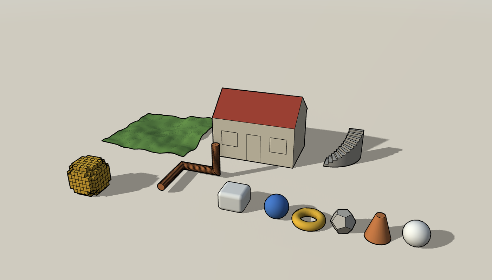
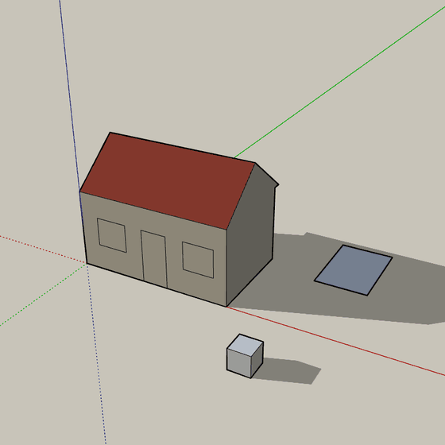
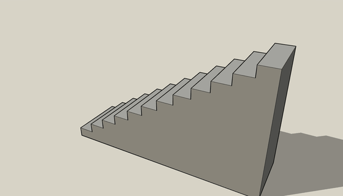
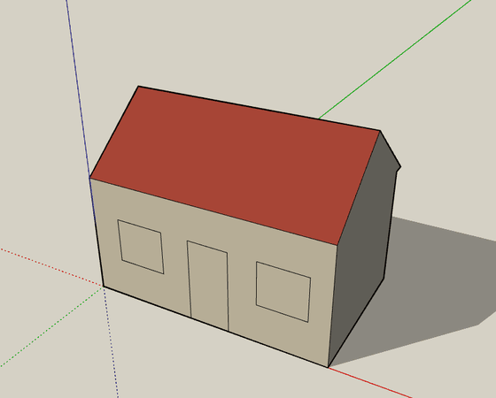
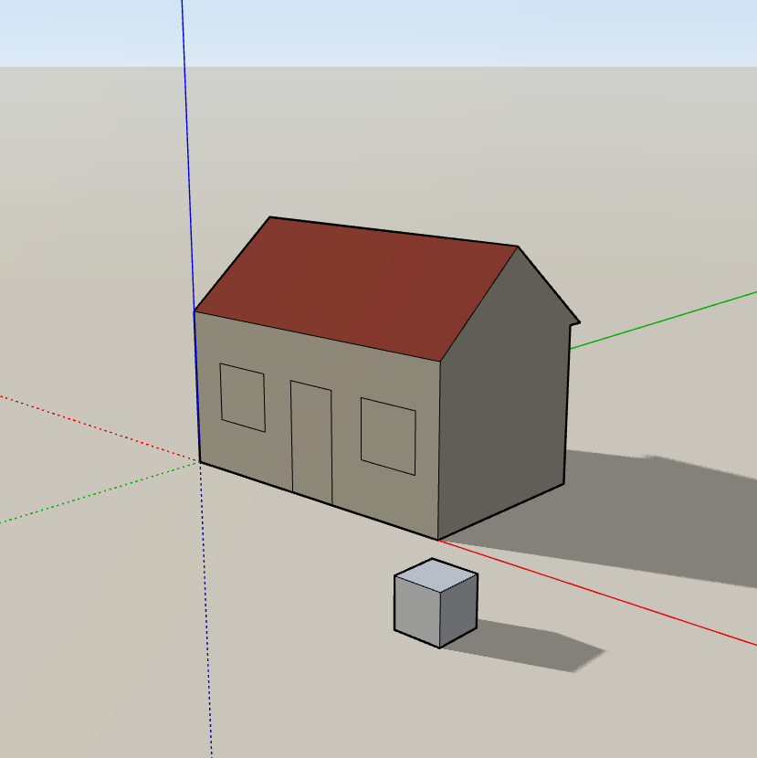
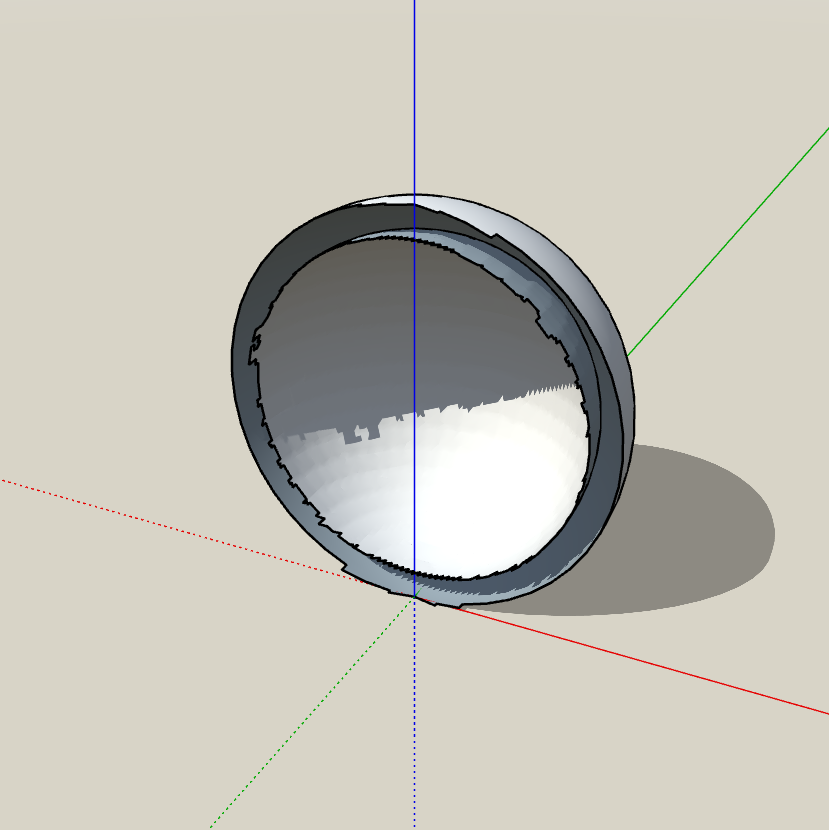
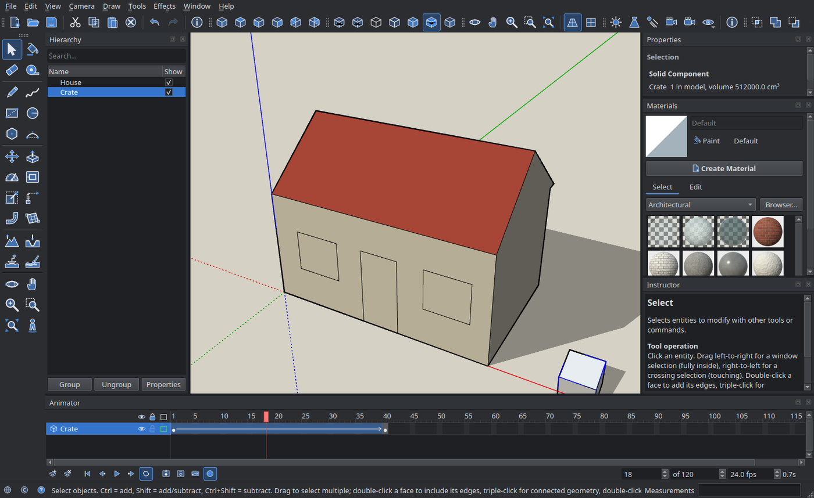

# GNUSketch

[](https://github.com/Dev1lroot/GNUSketch/actions/workflows/ci.yml)
[](https://github.com/Dev1lroot/GNUSketch/releases)
[](LICENSE)


**GNUSketch is a free and open-source 3D modeller built around direct drawing and
push/pull**: draw edges, faces appear by themselves, pull them into solids. It is
made for architectural and engineering models, and goes further than sketching:
physically based materials, components with animations and scripts, a first-person
**Game Mode** to walk through buildings and levels, and 3D printing files (3MF, AMF,
STL, PLY, OFF) in and out in real units.

Written from scratch in C++20 with Qt 6 and OpenGL 3.3, clean-room (no proprietary
code, formats or artwork); models are stored as open, documented JSON.



**[Read the documentation: every tool with a moving picture →](DOCUMENTATION.md)**

## What it does

| | |
|---|---|
|  | **Direct modelling.** Lines split and close into faces; faces are true n-gons with holes. Push/Pull, Move, Rotate, Scale with grips, Offset, Follow Me, Round Corners, Bend, Solid Tools (union, subtract, intersect, trim, split). Inference snaps to endpoints, midpoints, edges, faces, axes, parallels and intersections; lengths can snap to steps, and typed values are exact. |
|  | **Shapes beyond boxes.** Bend anything around an axis, ten parametric primitives, terrain sculpting with brushes, and effects: Noise, Blur, Decimate, Remesh to quads/hexagons/triangles, Voxelate, De-triangulate, Hollow and Solidify. |
|  | **Alive models.** Components with animation states, an Animator timeline with keyframes and motion tweens, entities scripted in JavaScript (doors, buttons, actors), rigid-body physics, and Game Mode to walk around in first person. |
|  | **Look and light.** PBR materials with maps and custom GLSL surface shaders, sun with shadows, point, spot and directional lights, ambient occlusion, and optional cinematic lighting: ray traced soft shadows and light rays. |
|  | **Made to be built.** Real units with chosen precision, 3D printing export and import (3MF, AMF, STL, PLY, OFF), Hollow with an exact wall thickness, Solidify for clean printable solids, OBJ (n-gons) and glTF 2.0 export. |



## Build

```sh
cmake -S . -B build -DCMAKE_BUILD_TYPE=RelWithDebInfo
cmake --build build -j
./build/gnusketch            # or: ./build/gnusketch model.gsketch
```

Requirements: a C++20 compiler, CMake ≥ 3.21, Qt ≥ 6.4 (Core, Gui, Widgets, OpenGL,
OpenGLWidgets, Svg) and an OpenGL 3.3 capable driver. Works on Wayland and X11.

Debian/Ubuntu packages:

```sh
sudo apt install build-essential cmake qt6-base-dev libqt6opengl6-dev libqt6svg6-dev qt6-image-formats-plugins
```

Fedora: `sudo dnf install gcc-c++ cmake qt6-qtbase-devel qt6-qtsvg-devel qt6-qtimageformats`
Arch: `sudo pacman -S cmake qt6-base qt6-svg qt6-imageformats`

Install system-wide with `sudo cmake --install build`.

Tests (none of them open a window on your desktop):

```sh
cd build && ctest                 # geometry kernel + file format tests
tools/headless-selftest.sh        # drives the real UI with synthetic input on Xvfb
./build/gnusketch --gl-probe      # renders one frame offscreen on your GPU, prints driver info
```

If the window does not open, run `./build/gnusketch --gl-probe` from a terminal and
include its output in the bug report.

## Plugins

File formats can come as plugins: shared libraries GNUSketch loads at start from
`GNUSKETCH_PLUGIN_PATH`, `~/.local/share/GNUSketch/GNUSketch/plugins`,
`<prefix>/lib/gnusketch/plugins` and `plugins/` beside the executable (Help > Plugins
lists what was found). A plugin adds File > Open / Import / Export entries for its
format, and may add a tab of its own to a component's Properties. See
`src/plugin/FormatPlugin.h`.

**Open Block Model** (`plugins/obm`, GNUBlocks' `.obm`): groups become components,
cubes become textured boxes, pictures come from the game's `textures` folder (beside
the model's `models` folder, or `GNUSKETCH_OBM_TEXTURES`). A picture that isn't
found is asked about ("Missing texture", Fix it: pick the file); picked from inside
a textures folder, that folder is remembered for the rest. Properties > OBM shows
and edits the group's, its cubes' and the model's tags. Exported, every box (and
lone rectangle) is a cube again; what wasn't changed is written back exactly as it
was read, tags, props and animations included.

## Documentation

[DOCUMENTATION.md](DOCUMENTATION.md) describes every tool, effect and panel with
pictures, and has the in-depth reference (geometry model, inference, file formats).
`TESTING.md` is the manual test checklist. The pictures are rendered by GNUSketch
itself: `tools/readme-media.sh` (a virtual screen; needs Python with Pillow).

## Not implemented yet

Component axes editing, 3-point arc and pie, rotated rectangle, text, dimensions,
section planes, tags/layers, scenes, an Intersect Faces command, folding of faces that
move out of plane, and playing the Animator's timeline in Game Mode.

## Contributing

Bug reports and pull requests are welcome; see [CONTRIBUTING.md](CONTRIBUTING.md)
for the clean-room policy and code style. `TESTING.md` is a manual test checklist.

## License

GNUSketch is free software: you can redistribute it and/or modify it under the
terms of the GNU General Public License as published by the Free Software
Foundation, either version 3 of the License, or (at your option) any later
version. See [LICENSE](LICENSE).

SketchUp is a trademark of Trimble Inc. GNUSketch is an independent project and is
not affiliated with, endorsed by, or connected to Trimble.
