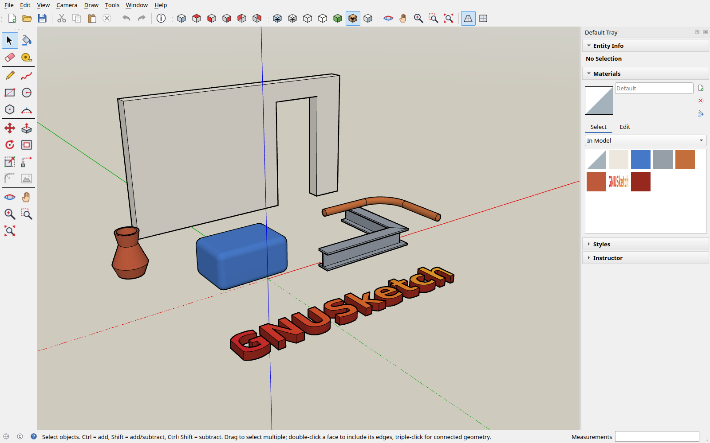

# GNUSketch

[](https://github.com/Dev1lroot/GNUSketch/actions/workflows/ci.yml)
[](LICENSE)

A free, native Linux 3D sketching tool with a push/pull workflow, written from
scratch in C++20 with Qt 6 Widgets and OpenGL 3.3 (core profile). Clean-room design:
no proprietary formats, code or artwork. All icons are original inline SVGs.



> **Status: early alpha (0.1).** The core modelling tools work. Expect rough edges
> and see "Not implemented yet" below.

## Build

```sh
cmake -S . -B build -DCMAKE_BUILD_TYPE=RelWithDebInfo
cmake --build build -j
./build/gnusketch            # or: ./build/gnusketch model.gsketch
```

Requirements: a C++20 compiler, CMake ≥ 3.21, Qt ≥ 6.4 (Core, Gui, Widgets, OpenGL,
OpenGLWidgets, Svg) and an OpenGL 3.3 capable driver. Works on Wayland and X11.

Debian/Ubuntu packages:

```sh
sudo apt install build-essential cmake qt6-base-dev libqt6opengl6-dev libqt6svg6-dev qt6-image-formats-plugins
```

Fedora: `sudo dnf install gcc-c++ cmake qt6-qtbase-devel qt6-qtsvg-devel qt6-qtimageformats`
Arch: `sudo pacman -S cmake qt6-base qt6-svg qt6-imageformats`

Install system-wide with `sudo cmake --install build`.

Tests (none of them open a window on your desktop):

```sh
cd build && ctest                 # geometry kernel + file format tests
tools/headless-selftest.sh        # drives the real UI with synthetic input on Xvfb
./build/gnusketch --gl-probe      # renders one frame offscreen on your GPU, prints driver info
```

If the window does not open, run `./build/gnusketch --gl-probe` from a terminal and
include its output in the bug report.

## Geometry model

* **Edges are first-class; faces are planar n-gons** with an outer loop and any
  number of holes. Nothing is triangulated in the model. Triangulation happens only
  on the fly for display and for triangle-based exporters (glTF, STL).
* **Drawing a line** welds its endpoints to nearby vertices, **splits every edge it
  crosses** (and itself) at the intersections, then runs face inference.
* **Face inference** builds the planar arrangement of all edges in each affected plane:
  * a closed planar loop gets a face;
  * a line across a face splits it;
  * a loop inside a face turns into a hole plus an inner face;
  * a loop drawn around an existing face makes that face a hole.

  Materials and texture placement carry over to the split faces. Re-tracing an
  existing edge heals a deleted face.
* **Erasing** an edge between two coplanar faces merges them, and collinear edge
  pieces are re-joined.
* **Push/Pull** extrudes faces. When a face's edges all border perpendicular faces,
  it stretches the solid instead. Coplanar side faces are healed, pushing through a
  solid cuts a hole, and the sides of circles and arcs become soft and smooth-shaded.
* **Follow Me** sweeps any profile face (with holes) along a path of lines, arcs
  or a closed outline, with mitred joints: pipes, T/H/I beams, mouldings and
  lathed shapes. Select the path and click the profile, or click the profile and
  then a path edge (Alt: a face's outline). Curved paths and profiles come out
  smooth-shaded.
* **Round Corners** (Tools menu, tool set, right-click) rounds the selected edges
  with a radius in mm and a number of segments, with a live preview. Edges between
  two faces get a rounded strip with mitred or spherical corners; corners of
  rectangles and polylines get a tangent arc.
* **Components**: select geometry and right-click **Make Component**. Copies made
  with Ctrl+Move (or copy/paste) share one definition. **Double-click** a component
  to edit it in place: the rest of the model fades, and every copy follows your
  edits live. Click outside it or press Esc to close it. Move, Rotate and Scale on
  a closed component only change that one copy's placement. Right-click
  **Make Unique** gives the selected copies their own definition, and **Explode**
  turns a component back into loose geometry. Exporters write components as
  ordinary geometry.

## Tools (SketchUp-compatible shortcuts)

| Key | Tool | Key | Tool |
|---|---|---|---|
| Space | Select | E | Eraser |
| B | Paint Bucket | L | Line |
| R | Rectangle | C | Circle |
| G | Polygon | A | 2 Point Arc |
| P | Push/Pull | M | Move / Copy (Ctrl) / Array (`5x`, `/5`) |
| Q | Rotate (Ctrl = copy) | S | Scale with grips (corner / edge / face, Shift, Ctrl) |
| F | Offset | T | Tape Measure (guides, model resize) |
| O / H / Z | Orbit / Pan / Zoom | Shift+Z | Zoom Extents |

Also Freehand, Zoom Window, **Follow Me** and **Round Corners** (Tools menu and the
tool set; no shortcut keys). Middle mouse orbits and Shift+middle pans with any
tool. The wheel zooms towards the cursor; double-clicking the middle button
re-centres the view.

**Scale** shows a box with grips around the selection (along a single component's
own axes). Corner grips scale uniformly, edge-midpoint grips scale two axes and
face-centre grips one axis, keeping the opposite grip fixed. Shift toggles
uniform scaling, Ctrl scales about the centre. Type `2`, `1.5,2` or `1,2,1`
while scaling, or right after to adjust it.

**Inference:** endpoint (green), midpoint (cyan), on edge (red), on face (blue),
origin, red/green/blue axis lines, "from point" alignment, guides, and magenta
directions of existing geometry: **Along Edge** (from a corner along the edges
that meet there, or their extension behind it) and **Parallel to Edge** (hover an
edge, then move away). Shift or Down arrow locks a magenta direction too.
The **arrow keys** lock the red, green or blue axis. In Rectangle, Circle and Rotate
they choose the drawing plane instead. **Shift** locks the current inference.

**Measurements box:** start typing numbers at any time, then press Enter. It accepts
`1500`, `1.5m`, `150cm`, `5'6"`, `w,h` for rectangles, `24s` for segment counts,
`<dx,dy,dz>` relative and `[x,y,z]` absolute coordinates. Values typed right after a
Push/Pull or Move adjust that operation.

## Follow Me

Follow Me sweeps a **profile** (any face, including one with holes) along a
**path** (a chain of edges) to build pipes, beams, handrails, mouldings and lathed
shapes.

1. Draw the profile as a face, usually at the start of the path and across it:
   a circle for a pipe, a ring for a hollow pipe, a T, H or I outline for a beam.
2. Draw the path: lines, arcs or a closed outline such as a circle or the edge of
   a box top.
3. Either select the path (or a face, to use its outline) and then click the profile
   with Follow Me, or start Follow Me, click the profile and then click a path edge.
   Clicking an edge follows its whole connected line, arc or circle. Alt-click a face
   to follow its outline. The path is highlighted before you click.

How the sweep behaves:

* The profile keeps its shape and its position relative to the path. A profile
  centred on the path stays centred; one beside it (a moulding along a box top)
  stays beside it.
* Corners are mitred: the profile is cut by the plane halfway between the two path
  directions, so beams and frames get clean corner joints.
* **Open paths** get end caps; the profile itself becomes the start cap.
  **Closed paths** (lathes, mouldings around an outline) start and end exactly on
  the profile and leave a closed solid with no caps.
* Curved paths (arcs, circles) and curved profile edges (circles, arcs) give soft,
  smooth-shaded surfaces. The faces take the profile's materials.
* Path edges are kept, so you can reuse or erase them afterwards.
* The sweep only adds geometry; it does not merge with or cut into existing
  solids. If the profile cannot follow the path (the path branches or is
  disconnected, doubles back on itself, or the profile lies along it) nothing
  changes and the status bar says why.

## Textures: drag and drop

Drag an image file (PNG, JPEG, WebP, BMP, TIFF, …) from your file manager onto a
face. It becomes a new material and the image is **fitted to that face**. Hold
**Ctrl** while dropping to **tile it at real-world size** instead (default tile
1 m wide; change it in Materials → Edit). If the face is part of the selection, every
selected face receives the texture. Dropping onto the Materials panel just adds the
material. Right-click → Texture → Fit to Face / Reset Position
re-maps selected faces. The Materials panel also ships generated textures (brick,
wood, tiles, grass, concrete, gravel, water, stone) and a colour palette.

**Images as planes:** drop an image file from the desktop or Dolphin onto **empty
space** and it becomes a flat rectangle showing the image, at 1 pixel = 1 mm. It lies
on the axis plane that faces the camera most: the ground in a top view, a vertical
wall (standing on the ground) in front or side views. The new plane is selected, so
you can Scale it to size or trace it straight away.

**Images from the clipboard:** Edit → Paste (Ctrl+V) places a copied image the same
way, under the mouse pointer: a screenshot, an image copied in a web browser or image
viewer, or image files copied in Dolphin.

## Copy and paste between windows

Copy (Ctrl+C) and Cut put the selected geometry on the **system clipboard**, together
with its soft/smooth edges, curves, materials and textures. Paste it into another
GNUSketch window, even a separate instance with a different model open. The paste
lands at the same coordinates and the Move tool starts, so you can place it right away.
Materials with the same name and image are reused instead of duplicated. The clipboard
data uses the documented `.gsketch` JSON under the MIME type `application/x-gnusketch`,
so other programs can read and write it too.

## Trace Image

**Tools → Trace Image…** (also in the tool set and the right-click menu) turns the
picture on the selected faces into outline geometry. It works on any face that shows
an image, typically one made by dropping an image into the scene.

* **Alpha cutout**: outlines the opaque parts of an image with a transparent
  background (logos, sprites, cut-out PNGs). Chosen by default when the image has
  transparency.
* **Dark shapes**: outlines black-on-white artwork (scanned drawings, stencils,
  text). **Light shapes** does the opposite.
* **Threshold** sets where the edge is (50 % = halfway between background and shape).
  **Smoothing** sets how far the outline may stray from the image, in pixels; larger
  values give fewer, straighter edges. **Ignore specks below** drops dust and noise.
* **Remove the background** cuts the shape out, leaving only faces inside the outline
  (holes such as the inside of an "O" stay open). Untick it to keep the whole face and
  just split it along the outline.

The preview updates live as you change the settings; OK keeps it as one undo step.
Outlines are traced with sub-pixel precision and simplified, and sharp corners are
restored, so rectangular artwork stays rectangular. The pieces keep the image as their
texture and can be push/pulled into solid letters, logos or stencils. Only one copy of
the image is traced, so on a tiled texture fit the image to the face first.

## File formats

* **`.gsketch` (native)** is plain, documented JSON (see `src/io/NativeFormat.h`). It
  stores vertices, edges (soft/smooth/hidden/curve flags), n-gon faces with holes,
  per-side materials and planar UV mappings, guides, camera and style. Textures are
  embedded as their original PNG/JPEG bytes (base64).
* **OBJ + MTL** (export/import) keeps n-gon faces; only faces with holes are
  triangulated, because OBJ cannot express holes. Loose edges are written as `l`.
  Y-up on disk.
* **glTF 2.0** (export) produces a single self-contained `.gltf`, Y-up, with PBR
  materials and textures.
* **STL** (export) is binary, in millimetres.

**To get FBX:** export OBJ or glTF, then convert with Blender (File → Import, then
File → Export → FBX) or with assimp (`assimp export model.gltf model.fbx`).

## Code layout

```
src/core    Math, Mesh (B-rep kernel + face inference), Triangulate, Units, Document (undo),
            FollowMe (profile sweeps), RoundCorners (fillets), ImageTrace (image outlines)
src/io      NativeFormat, ObjIO, GltfExport, StlExport, ImageUtil
src/render  Camera, Renderer (GL 3.3: faces, geometry-shader wide/dashed lines, sky/ground)
src/app     Viewport, Inference, tools (Draw/Modify/Camera), Panels (tray), MainWindow, Icons
tests       kernel and I/O tests
```

## Not implemented yet

Groups, nested components, component axes editing, 3-point arc and pie, rotated rectangle, text,
dimensions, section planes, tags/layers, scenes, shadows, intersect faces, the
texture position editor, and folding of faces that move out of plane.

## Contributing

Bug reports and pull requests are welcome; see [CONTRIBUTING.md](CONTRIBUTING.md)
for the clean-room policy and code style. `TESTING.md` is a manual test checklist.

## License

GNUSketch is free software: you can redistribute it and/or modify it under the
terms of the GNU General Public License as published by the Free Software
Foundation, either version 3 of the License, or (at your option) any later
version. See [LICENSE](LICENSE).

SketchUp is a trademark of Trimble Inc. GNUSketch is an independent project and is
not affiliated with, endorsed by, or connected to Trimble.
